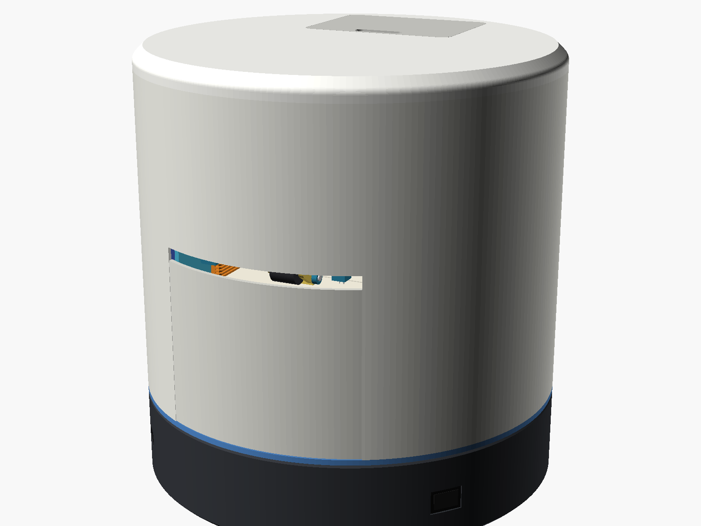
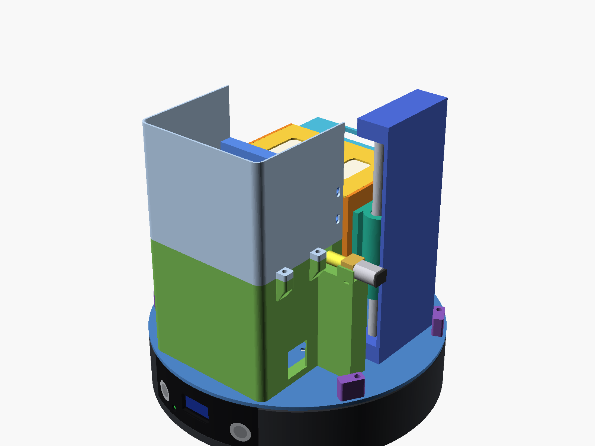
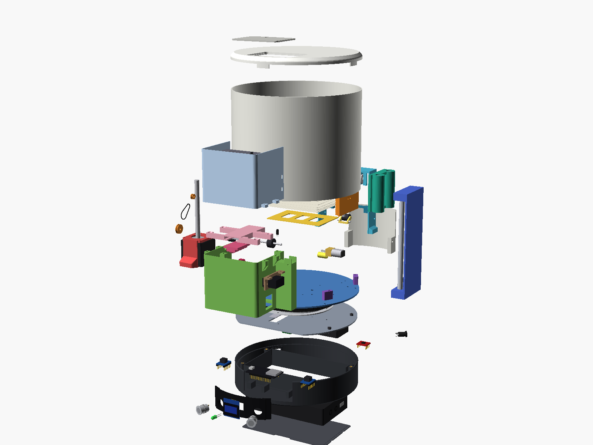
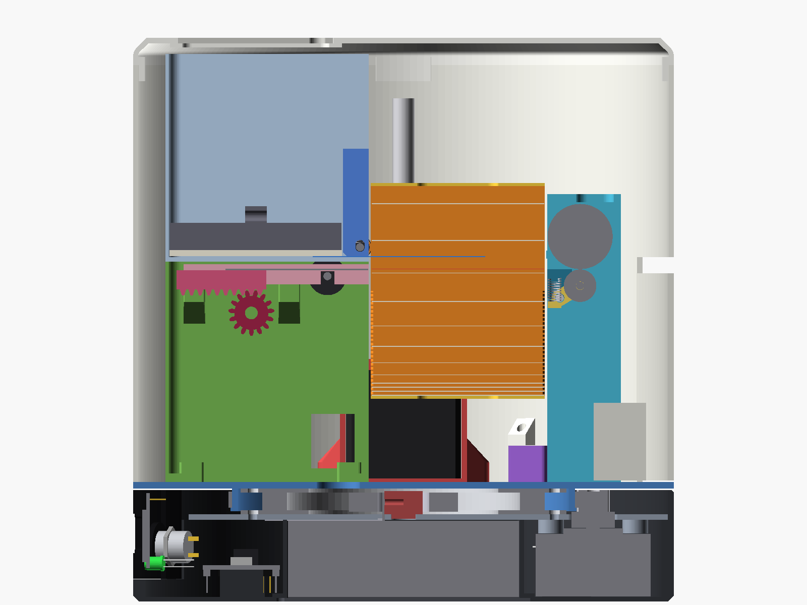

# Poker Dealer: a compact ESP32 card shuffler and dealer

An open-hardware, battery-powered Texas Hold'em dealer that sits in the middle of the table.
Drop the collected cards in the hopper, press **GO**: it loads all 52 cards into a 52-shelf
random-access rack, checks the count, and throws two hole cards to every player, then burn + flop,
burn + turn and burn + river, one GO press per street. The dealer button advances by itself.

<!-- HERO -->

<!-- /HERO -->

## Features

* **True random-access shuffle**: every dealt card comes from a uniformly random occupied shelf
  (`esp_random()` with rejection sampling). There is no mechanical shuffle pass and no shuffle
  pattern to learn.
* **2-10 players**, seats evenly spaced around 360 degrees, board in the gap between the last and the
  first seat. Player count and button seat are stored in NVS.
* **Correct dealing order**: hole cards one at a time, clockwise, starting left of the button; 3 burns +
  5 board cards; misdeal keeps the button, an early "everyone folded" end advances it.
* **One turret does everything**: rack, loader, pusher and launcher sit on a lazy-susan turret that
  aims the throw (NEMA17 + 200T ring, 10:1).
* **Variable throw**: one 130 motor wheel launcher, full power to a seat, medium to the board (fanned),
  a slow dribble for burns onto a burn spot beside the board. At the end of the hand the burn pile goes
  back into the hopper with the other cards.
* **Fault handling**: loader/launcher jam, empty shelf, double feed (beam-blocked time), card count
  not 52, homing failures, low battery. The machine stops and waits for GO.
* **Battery powered**: TalentCell 3S 6 Ah in the base, about 280 hands (about 7-14 h of play) per
  charge, charge jack on the base wall. Steppers off and servo detached when idle.
* **Compact**: everything incl. the battery inside a smooth cylinder; see the size result below.
* **Two flush buttons + LED**, optional 0.96 in OLED status screen.
* Parametric OpenSCAD CAD with one shared parameter file that also generates the firmware geometry.

## Size

<!-- SIZE_REPORT -->

Measured from the meshes of every placed part (printed, vendor, cards) at turret angles
0..315 deg (step 45) and rack at 0 and 81 mm.

| | measured | hard limit | margin | stretch target | gap to stretch |
|---|---|---|---|---|---|
| footprint (2 x max radius) | **199.0 mm** | 200 mm | +1.0 mm | 170 mm | +29.0 mm |
| height | **207.5 mm** | 220 mm | +12.5 mm | 180 mm | +27.5 mm |

Hard limits: **PASS**. Max axis-aligned bounding box side: 199.0 mm.

Radius drivers: base_shell 99.5, ui_bezel 99.5, turntable 99.5, slot_panel 99.5, turret_shell 99.5.
Height drivers: top_cap 207.5, hopper_lid 207.5, rack_comb_px 205.0, rack_comb_nx 205.0.

The size-optimization pass and every size trade-off are in [docs/DECISIONS.md](docs/DECISIONS.md). The stretch target cannot be met with this battery and a 52-slot random-access rack (D-01, D-04).
<!-- /SIZE_REPORT -->

## Renders

| | | |
|---|---|---|
|  |  |  |
| Turret with the shell removed | Exploded view | Section: rack, pusher, launcher |

Turret rotation: [renders/turret_rotation.gif](renders/turret_rotation.gif). All renders and every
printed part: [renders/](renders/) (index in [BUILD.md](docs/BUILD.md#render-index)).

## How it works

| Stage | What happens |
|---|---|
| Load | The N20 roller feeds the bottom card from the hopper into the next empty shelf at the load station. The IR beam counts cards and flags double feeds. |
| Select | The firmware picks a random occupied shelf. The T8 leadscrew lifts the rack so that shelf sits at the eject station, 3 shelves below the load station. |
| Aim | The turret turns to the seat, board or burn angle (0-360 degrees only, so all turret wiring is one ribbon-cable clock spring in the bearing centre). |
| Push + throw | The MG90S rack-and-pinion blade pushes the card out between the shelf fins into the launcher wheel nip. |

Details: [docs/ARCHITECTURE.md](docs/ARCHITECTURE.md) and [docs/DECISIONS.md](docs/DECISIONS.md)
(every size trade-off, e.g. why the shelf pitch is 1.5 mm and the ring is 10:1).

## Repository map

| Path | Contents |
|---|---|
| [firmware/](firmware/) | PlatformIO project (`esp32dev` + `native` tests), [config.h](firmware/include/config.h) with all calibration constants |
| [docs/FIRMWARE.md](docs/FIRMWARE.md) | Usage, buttons, OLED, faults |
| [docs/BUILD.md](docs/BUILD.md) | Print settings, assembly order with renders, wiring, first flash, calibration, troubleshooting |
| [docs/BOM.csv](docs/BOM.csv) | Bought parts with specs, quantities, estimated prices (PLN/EUR per line) and sources |
| [cad/](cad/) | OpenSCAD sources, [params.scad](cad/params.scad) (all shared dimensions), [cad/stl/](cad/stl/) print-ready STLs, [cad/vendor/](cad/vendor/) bought-part models, [cad/parts.csv](cad/parts.csv) print list |
| [renders/](renders/) | Assembly views, exploded view, section view, every printed part |
| [electronics/](electronics/) | [Wiring diagram](electronics/wiring.png) ([svg](electronics/wiring.svg), [WireViz source](electronics/wiring.yml)), [pin table](electronics/PINS.md) ([csv](electronics/pins.csv)), [power tree](electronics/power.png), [power budget](electronics/POWER.md) |
| [docs/ARCHITECTURE.md](docs/ARCHITECTURE.md), [docs/DECISIONS.md](docs/DECISIONS.md) | Layout, frames, design decisions and size trade-offs |
| [tools/](tools/) | Consistency checks: `check_pins.py` (firmware = pin table = wiring), `check_bom.py` (CAD vendor parts = BOM), geometry generator and CAD checks |
| [qa/](qa/) | Review report per QA cycle, `qa/FINAL.md` |
| `Makefile` | `make all` builds firmware, runs tests, exports STLs and renders, draws the wiring and runs every check |

## Electronics at a glance

ESP32 DevKit V1, 2x TMC2209 (turret 16 usteps, rack 8 usteps, shared EN), DRV8833 on 5 V (loader N20 +
launcher 130 motor), MG90S pusher, 2 IR break-beams, A3144 hall + microswitch for homing,
Mini560 12->5 V buck, TalentCell YB1206000-USB 3S 6 Ah battery behind a rocker switch.
Peak draw 2.85 A at 12 V even if every load peaked at once (limit 3 A). Idle 0.86 W.


## Quick start

```sh
make all                                   # everything: firmware, tests, STLs, renders, wiring, checks
cd firmware && pio run -e esp32dev -t upload
```

Then follow [docs/BUILD.md](docs/BUILD.md) section 8 (calibration) and [docs/FIRMWARE.md](docs/FIRMWARE.md).

## Known issues

* **Not yet built physically.** All numbers (clearances, launcher speeds, DOUBLE_MS, power draw)
  are design values and estimates; they need the calibration in BUILD.md.
* **Shelf pitch 1.5 mm with 0.9 mm fins** is at the limit of a 0.4 mm nozzle (fins are exactly
  2 perimeters, a noted exception to the 1.2 mm minimum wall). Print the test comb first.
  Warped or bent cards may not fit a 0.6 mm slot.
* **Stretch height target (180 mm) is not reachable** with this battery under the turret and a
  52-shelf random-access rack (DECISIONS D-04).
* **IR emitters are always on** (44 mA at 5 V = 0.275 W, about 32 % of the 0.86 W idle draw). A
  GPIO-switched emitter supply would stretch the idle time about 1.47x (65 h to about 96 h); there is no
  free safe GPIO planned for it in this revision.
* **Battery voltage reading** depends on resistor tolerance and ESP32 ADC calibration (+/-2 %);
  calibrate `VBAT_CAL` against a multimeter.
* Power figures are calculated (electronics/power_budget.py), not measured.

### Known deviations from the spec

* **No burn tray on the turret** ([DECISIONS D-20](docs/DECISIONS.md)): it cannot fit inside the
  envelope, because a card leaving the nip needs more free path than there is. Burns are launched very
  slowly, face down, onto a burn spot on the table at `BURN_DEG` = 22 degrees, next to the board. Collect
  the burn pile with the board cards at the end of the hand.
