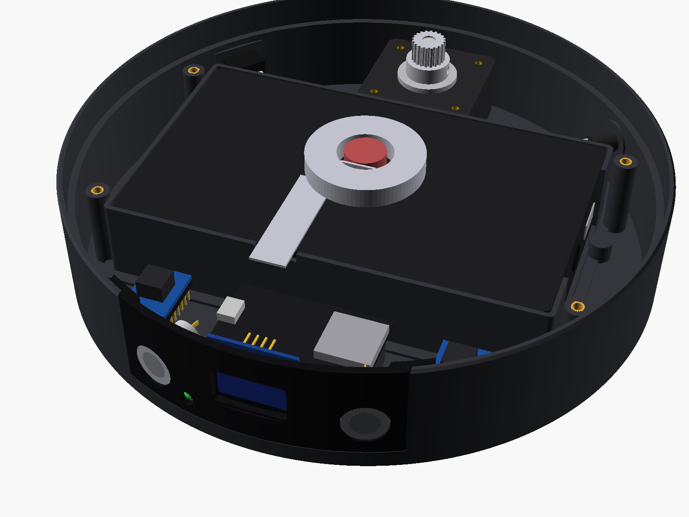
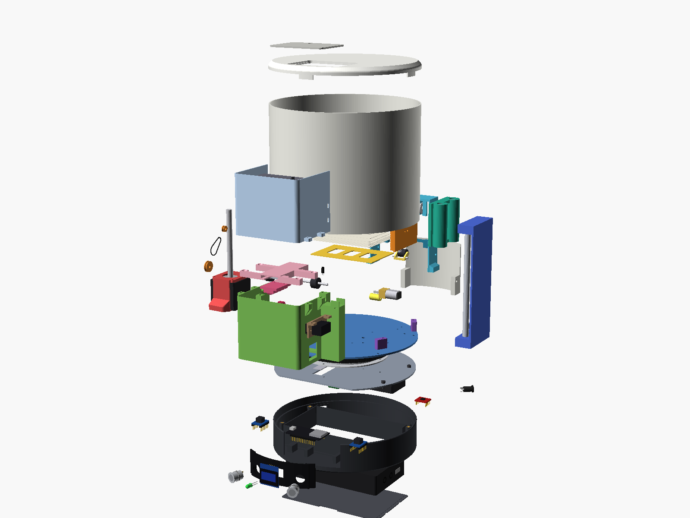
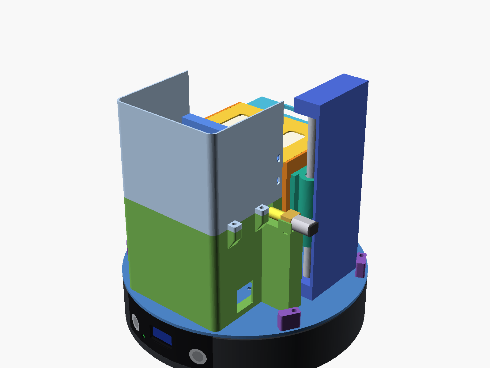
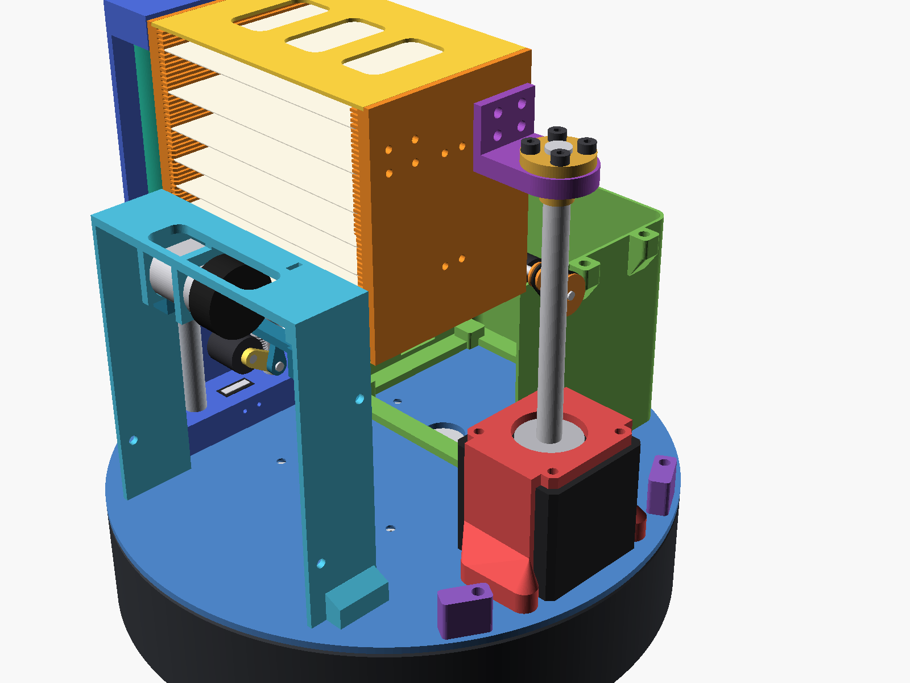
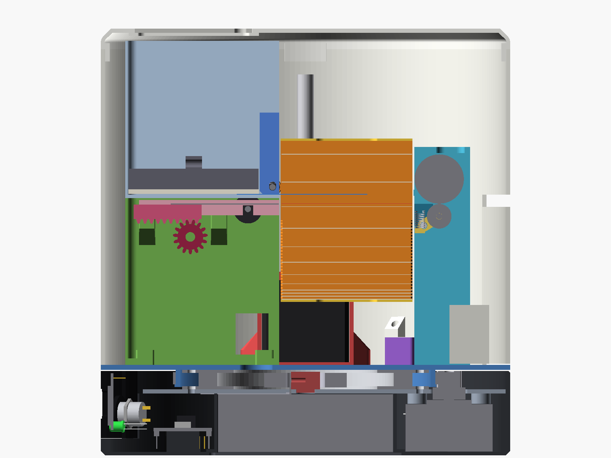

# Build guide

This guide is for someone with an FDM 3D printer, a soldering iron and a multimeter.
Plan on 2-3 days of printing and one weekend of assembly and calibration.

Reference files:

| What | Where |
|---|---|
| Bought parts | [docs/BOM.csv](BOM.csv) |
| Printed parts + print settings | [cad/parts.csv](../cad/parts.csv), STLs in [cad/stl/](../cad/stl/) |
| Renders (assembly, exploded, section, every part) | [renders/](../renders/) |
| Wiring diagram | [electronics/wiring.png](../electronics/wiring.png) ([svg](../electronics/wiring.svg), source [wiring.yml](../electronics/wiring.yml)) |
| Pin table | [electronics/PINS.md](../electronics/PINS.md) |
| Power tree / budget | [electronics/power.png](../electronics/power.png), [electronics/POWER.md](../electronics/POWER.md) |
| Firmware usage, buttons, faults | [docs/FIRMWARE.md](FIRMWARE.md) |
| Calibration constants | [firmware/include/config.h](../firmware/include/config.h) |
| Shared geometry (pitch, offsets, ratios) | [cad/params.scad](../cad/params.scad), generated into `firmware/include/geometry.h` |
| Why things are the way they are | [docs/DECISIONS.md](DECISIONS.md), [docs/ARCHITECTURE.md](ARCHITECTURE.md) |


---

## 1. Tools

* FDM printer with at least a 220 x 220 x 250 mm bed and a **0.4 mm nozzle** (the rack combs need it)
* Soldering iron (temperature controlled) with a **heat-set insert tip** for M3 inserts (or a conical tip)
* Multimeter (needed for the buck voltage, TMC2209 VREF and coil pairs)
* Small Phillips + 2.5 mm hex key (M3 socket heads), 1.5 mm hex for pulley set screws
* Wire stripper, flush cutters, heat gun or lighter for heat-shrink
* Metal saw or rotary tool with cut-off disc (8 mm rods, steel blade strip), file / sandpaper
* Calipers (to check the test comb and card clearance)
* USB cable (micro-USB, data capable) and a computer with [PlatformIO](https://platformio.org/) (VS Code extension or `pip install platformio`)
* Optional: superglue/CA (belt on the ring hub, magnet), thread locker for set screws

## 2. Buy the parts

Order everything in [BOM.csv](BOM.csv). Prices are rough per-line estimates
(PLN / EUR, late 2026); the whole kit is about **870 PLN / 205 EUR**, of which the battery is
about a quarter. Notes:

* **Battery**: TalentCell YB1206000-USB, 145 x 85 x 28 mm. Measure yours: the base cradle is
  sized for these numbers (`BATT_L/W/H` in `cad/params.scad`). If your pack differs, change the
  numbers and re-export the base.
* **Rack stepper**: NEMA17 with an *integrated* T8x8 leadscrew (the screw is the motor shaft),
  not a coupler version, **100 mm** screw (or cut a 150 mm one; DECISIONS D-10). It mounts at the
  bottom of the turret, screw pointing up.
  The firmware assumes 8 mm lead (`LEAD_MM`).
* **GT2 20T pulley**: file or turn off the top flange so it meshes with the belt-on-hub ring.
* **TMC2209 modules**: the VREF math below assumes 0.11 ohm sense resistors (BTT/FYSETC style).
* **IR break-beams**: open-collector receivers (Adafruit 2167 style). Emitters and receivers run on 5 V; the
  receiver output is open-collector and only pulled up to 3.3 V by the ESP32, so it is safe.

## 3. Print the parts

### General settings

| Setting | Value |
|---|---|
| Material | PETG for everything structural and the shell (heat from motors, and it is tougher). **PLA for the rack combs and rack plates** (stiffer, crisper fins). PLA is fine for a first test fit of anything. |
| Nozzle | 0.4 mm |
| Layer height | 0.2 mm default, **0.12 mm** for the rack combs, 0.15 mm for the turntable (ring hub) and the pusher gears (see table) |
| Walls | 3 perimeters (1.2 mm), 4 for parts with heat-set inserts |
| Top / bottom | 5 / 4 layers |
| Infill | 20 % gyroid default, 40 % for motor mounts and the turntable |
| Supports | none unless the table says so; every part is already in print orientation in `cad/stl/` |
| Inserts | parts with M3 heat-set inserts get 4 walls (table) |
| Tolerance | all fits use `TOL = 0.2 mm` per side (`cad/params.scad`). If your printer is tighter or looser, change `TOL` and re-export. |

### Per-part list

The authoritative list with material, layer height, walls, infill, supports and orientation for each
STL is [cad/parts.csv](../cad/parts.csv). Print one of each STL in [cad/stl/](../cad/stl/)
unless `qty` in that file says otherwise. The per-part renders are in `renders/` (one PNG per
printed part).

<!-- PRINT_TABLE: generated from cad/parts.csv (layer/walls/infill added per the general settings) -->
| Part | STL | Qty | Material | Layer | Walls | Infill | Supports | Orientation | Notes |
|---|---|---|---|---|---|---|---|---|---|
| [base_shell](../renders/parts/base_shell.png) | [base_shell.stl](../cad/stl/base_shell.stl) | 1 | PETG | 0.2 | 4 | 20 % | none | upright floor on bed | battery-door rebate ceiling is a 4 mm horizontal cantilever ring at z 1.2 (no supports needed); UI cut is a notch from the top edge; rocker/jack hole roofs <= 13 mm |
| [battery_door](../renders/parts/battery_door.png) | [battery_door.stl](../cad/stl/battery_door.stl) | 1 | PETG | 0.2 | 3 | 20 % | none | flat outside face on bed | 4x M3 CSK into floor inserts; finger notch through the flange edge; battery drops out downward |
| [base_deck](../renders/parts/base_deck.png) | [base_deck.stl](../cad/stl/base_deck.stl) | 1 | PETG | 0.2 | 4 | 40 % | none | upside down (top face on bed) | pancake NEMA standoffs up; radial ribbon slot (D-19); full-chord UI cut |
| [hall_post](../renders/parts/hall_post.png) | [hall_post.stl](../cad/stl/hall_post.stl) | 1 | PETG | 0.2 | 3 | 20 % | none | upside down (sensor face on bed) | pegs into the deck; A3144 glued in the groove |
| [spool_hub](../renders/parts/spool_hub.png) | [spool_hub.stl](../cad/stl/spool_hub.stl) | 1 | PETG | 0.2 | 3 | 40 % | none | upside down (top on bed) | static clock-spring hub for the ribbon harness (D-19); pegs into the deck |
| [ui_bezel](../renders/parts/ui_bezel.png) | [ui_bezel.stl](../cad/stl/ui_bezel.stl) | 1 | PETG black | 0.2 | 3 | 20 % | none | upright (installed Z up) | radial 12 mm button / 5 mm LED holes; OLED window top is a 23 mm bridge; bosses keep >= 1.2 mm behind the flush recesses |
| [turntable](../renders/parts/turntable.png) | [turntable.stl](../cad/stl/turntable.stl) | 1 | PETG | 0.15 | 4 | 40 % | none | upside down (top face on bed) | 200T ring hub (GT2 belt glued teeth-out D-11) with a 0.6 mm seat lip; CSK holes print as upward cones; magnet through-hole |
| [shell_anchor](../renders/parts/shell_anchor.png) | [shell_anchor.stl](../cad/stl/shell_anchor.stl) | 4 | PETG | 0.2 | 4 | 40 % | none | upright | CSK M3 from below into the turntable; shell tab screwed from above (cap off) |
| [rack_comb](../renders/parts/rack_comb.png) | [rack_comb.stl](../cad/stl/rack_comb.stl) | 2 | PLA | 0.12 | 2 on fins, 3 elsewhere | 100 % | none | lying on outer face fins vertical | fins 0.9 mm = documented exception to the 1.2 mm wall rule (D-01); pilot holes 3.3 deep keep 1.2 mm; both combs identical (one turned 180 deg) |
| [rack_bottom_plate](../renders/parts/rack_bottom_plate.png) | [rack_bottom_plate.stl](../cad/stl/rack_bottom_plate.stl) | 1 | PLA | 0.2 | 3 | 100 % | none | flat | 1.2 mm; glued (CA) into the comb rebates |
| [rack_top_plate](../renders/parts/rack_top_plate.png) | [rack_top_plate.stl](../cad/stl/rack_top_plate.stl) | 1 | PLA | 0.2 | 3 | 100 % | none | flat | 1.2 mm; glued (CA) into the comb rebates |
| [rack_carriage](../renders/parts/rack_carriage.png) | [rack_carriage.stl](../cad/stl/rack_carriage.stl) | 1 | PETG | 0.2 | 3 | 40 % | none | upright (bores vertical) | 4x LM8UU pressed in; 4x M3 thread-forming into comb pilots; counterbore roofs are small |
| [rack_nut_arm](../renders/parts/rack_nut_arm.png) | [rack_nut_arm.stl](../cad/stl/rack_nut_arm.stl) | 1 | PETG | 0.2 | 3 | 40 % | none | arm flat on bed flange vertical | T8 flange nut with 4x M3 thread-forming in 2.5 pilots (1.45 mm to the nut bore) |
| [rack_motor_mount](../renders/parts/rack_motor_mount.png) | [rack_motor_mount.stl](../cad/stl/rack_motor_mount.stl) | 1 | PETG | 0.2 | 4 | 40 % | none | upside down (face plate on bed) | seat is one solid 43 mm bridge (no holes); feet are 45 deg wedges |
| [rail_frame](../renders/parts/rail_frame.png) | [rail_frame.stl](../cad/stl/rail_frame.stl) | 1 | PETG | 0.2 | 4 | 40 % | none | lying on web outer face | rod bores Ø8.1 horizontal (small roofs); microswitch pocket |
| [loader_frame](../renders/parts/loader_frame.png) | [loader_frame.stl](../cad/stl/loader_frame.stl) | 1 | PETG | 0.2 | 3 | 20 % | none | upright bottom lip on bed | ledges / IR block / tabs have 45 deg under-chamfers; N20 cradle is an open trough; harness windows bridge 16-18 mm |
| [hopper_body](../renders/parts/hopper_body.png) | [hopper_body.stl](../cad/stl/hopper_body.stl) | 1 | PETG | 0.2 | 3 | 20 % | none | upright floor on bed | load plane = floor top = Z_LOAD; slotted gate fixings; open U-slot for the pinch shaft |
| [hopper_gate](../renders/parts/hopper_gate.png) | [hopper_gate.stl](../cad/stl/hopper_gate.stl) | 1 | PETG | 0.2 | 3 | 20 % | none | lying on its front face | sets the 0.45 mm throat; holds the driven pinch rollers + 2 springs + load IR emitter (D-18); roller-cavity roofs bridge 8.6 mm |
| [hopper_weight](../renders/parts/hopper_weight.png) | [hopper_weight.stl](../cad/stl/hopper_weight.stl) | 1 | PETG 100% infill | 0.2 | 3 | 100 % | none | flat | 2 hex pockets for M8 nuts as ballast |
| [hopper_lid](../renders/parts/hopper_lid.png) | [hopper_lid.stl](../cad/stl/hopper_lid.stl) | 1 | PETG | 0.2 | 3 | 20 % | none | flat top face on bed | drops into the top cap; through finger slot |
| [loader_coupler](../renders/parts/loader_coupler.png) | [loader_coupler.stl](../cad/stl/loader_coupler.stl) | 1 | PETG | 0.2 | 3 | 40 % | none | upright | N20 D-shaft to 3 mm shaft; 2x M3 grubs self-tapped |
| [loader_pulley_feed](../renders/parts/loader_pulley_feed.png) | [loader_pulley_feed.stl](../cad/stl/loader_pulley_feed.stl) | 1 | PETG | 0.15 | 3 | 100 % | none | flat | O-ring pulley Ø12 groove on the feed shaft (D-18); 45 deg V groove |
| [loader_pulley_pinch](../renders/parts/loader_pulley_pinch.png) | [loader_pulley_pinch.stl](../cad/stl/loader_pulley_pinch.stl) | 1 | PETG | 0.15 | 3 | 100 % | none | flat | O-ring pulley Ø5.8 groove on the pinch shaft (D-18) |
| [pusher_guide](../renders/parts/pusher_guide.png) | [pusher_guide.stl](../cad/stl/pusher_guide.stl) | 1 | PETG | 0.2 | 3 | 20 % | none | upright (wing bottoms on bed) | blade-channel roof and floor are bridges <= 28 mm |
| [pusher_slider](../renders/parts/pusher_slider.png) | [pusher_slider.stl](../cad/stl/pusher_slider.stl) | 1 | PETG | 0.15 | 3 | 100 % | none | upside down (flange on bed teeth up) | m1 gear rack (whole teeth only); blade fixed with 2x M2 |
| [pusher_pinion](../renders/parts/pusher_pinion.png) | [pusher_pinion.stl](../cad/stl/pusher_pinion.stl) | 1 | PETG | 0.15 | 3 | 100 % | none | flat | m1 15T involute; pressed on the MG90S spline + horn screw |
| [servo_mount](../renders/parts/servo_mount.png) | [servo_mount.stl](../cad/stl/servo_mount.stl) | 1 | PETG | 0.2 | 3 | 40 % | none | lying on its -X face | screws up into the pusher-guide wings |
| [launcher_frame](../renders/parts/launcher_frame.png) | [launcher_frame.stl](../cad/stl/launcher_frame.stl) | 1 | PETG | 0.2 | 3 | 40 % | none | upside down (top plate on bed) | 45 deg wedge feet; motor cheek holes bridge 20 mm |
| [launcher_floor](../renders/parts/launcher_floor.png) | [launcher_floor.stl](../cad/stl/launcher_floor.stl) | 1 | PETG | 0.2 | 3 | 20 % | none | upside down (top face on bed) | entry floor top = Z_EJECT; idler pivot lugs; IR receiver cup with 1.5 mm roof; end blocks with full-wall inserts |
| [idler_arm](../renders/parts/idler_arm.png) | [idler_arm.stl](../cad/stl/idler_arm.stl) | 1 | PETG | 0.2 | 3 | 40 % | none | standing on the lever-end face | bell crank; 3 mm axle pressed in |
| [slot_panel](../renders/parts/slot_panel.png) | [slot_panel.stl](../cad/stl/slot_panel.stl) | 1 | PETG | 0.2 | 4 | 20 % | none | upright | flush shell patch under the exit slot; 2 inserts; screws through the launcher side plates (D-20) |
| [turret_shell](../renders/parts/turret_shell.png) | [turret_shell.stl](../cad/stl/turret_shell.stl) | 1 | PETG | 0.2 | 3 | 20 % | none | upside down (top rim on bed) | front notch prints open-ended; tabs are 45 deg wedges resting on the shell anchors |
| [top_cap](../renders/parts/top_cap.png) | [top_cap.stl](../cad/stl/top_cap.stl) | 1 | PETG | 0.2 | 3 | 20 % | none | upside down (top on bed) | 45 deg chamfer + r4 printable fillet; lid ledge is a 1.5 mm overhang |
<!-- /PRINT_TABLE -->

### Rack combs: print these first and test

The rack has 52 shelves at **1.5 mm pitch**: 0.9 mm fins and 0.6 mm slots for a 0.30 mm card
(0.30 mm clearance, see [DECISIONS.md D-01](DECISIONS.md)). This is the part that decides whether
the machine works.

* **0.4 mm nozzle, fins = 0.9 mm = exactly 2 perimeter lines.** In the slicer, make sure the fins are
  printed as 2 walls, with no gap fill and no single thin-wall extrusion. PrusaSlicer/Orca: enable
  "Detect thin walls" **off**, check in the preview that every fin is 2 clean lines.
* PLA. Comb lies on its outer face (fins vertical, no overhangs), **0.12 mm layers**, slow outer walls
  (25-30 mm/s), cooling 100 %, no ironing, no brim on the fin side. Print both combs (identical; one is
  turned 180 degrees in the assembly).
* Turn off "elephant foot compensation" only if it eats the first fin; otherwise keep it at 0.1-0.2 mm.
* **Test first**: in the slicer, cut a ~20 mm piece out of `rack_comb.stl` with a cut plane parallel to
  the fins (about 13 slots) and print only that. Check:
  1. Calipers: fin 0.85-0.95 mm, slot 0.55-0.65 mm.
  2. A real card slides into every slot under its own weight when the comb is tilted ~30 degrees,
     and does not touch the slot above when it lies flat.
  3. No stringing between fins (clean with a 0.5 mm feeler or a card edge).
  If slots are too tight, raise `TOL` slightly or reduce extrusion multiplier by 2-3 % for this part only.
  Do **not** change `SHELF_PITCH` without re-running the CAD export and the firmware build
  (`tools/gen_geometry.py` keeps them in sync).

## 4. Prepare the hardware

1. **Heat-set inserts**: iron at ~220 C (PLA) / ~245 C (PETG). Put the insert on the hole, let the
   iron push it in under its own weight, stop 0.2 mm proud and flatten with a flat metal plate
   while it is warm. Do all inserts before any assembly.
2. **Rods**: cut the two 8 mm rods to **157 mm**
   (hardened rods: score with a cut-off disc, then snap). Chamfer the ends so the LM8UU balls are not damaged.
3. **Pusher blade**: cut the 0.5 mm stainless strip to the blade size in the CAD (24 mm wide). Deburr
   the edges and round the corners: it must slide between cards without catching.
4. **Turret ring**: the 200T ring is a printed hub with 400 mm of GT2 6 mm belt glued around it
   **teeth-out**. Dry-fit first: the belt must close exactly with the two ends butted at a tooth gap
   (trim if needed). Glue with CA in short sections, clamp with cable ties until cured, and check
   that the 20T pulley meshes all the way round.
5. **Magnet**: the A3144 is unipolar and switches on a **south** pole facing its marked (flat) face.
   Mark the side of the magnet that makes the sensor switch (test with the sensor wired, LED or meter),
   then glue it into the turntable underside pocket with that side down.
6. **Shafts, rollers, wheel**: cut the 3 mm silver-steel rod into the feed shaft (98.5 mm), the idler
   axle (17.6 mm) and two idler pivot pins (5.7 mm); chamfer the ends. Press the two 14 mm feed rollers
   onto the feed shaft, the 12 mm pinch idler onto its axle, and the 24 mm drive wheel onto the 130
   motor shaft. Spin each one: they must run true.

## 5. Mechanical assembly

Follow the order below. Part names are the STL names in `cad/stl/`. Pictures: the full assembly
views, the exploded view (stack order) and the section view through rack, pusher and launcher
(card path) in `renders/`; see the [render index](#render-index) at the end.

**Base (static)**



*`renders/base_electronics.png`: base with the deck and bearing hidden: battery, ribbon clock spring
on its hub, pancake NEMA17 with its pulley, ESP32 and drivers in the crescents, UI bezel.*

1. (`renders/assembly_back_ui.png`, `assembly_base_power.png`) **base_shell**: fit the panel parts into
   the wall first, while it is easy to reach: DC charge jack (M8 nut) and rocker switch on the back wall,
   and the **ui_bezel** with the GO and SET buttons, the LED and the OLED at the front.
2. **Battery**: slide the TalentCell in from below and close it with the **battery_door** (4x M3 CSK
   into the floor inserts). The battery drops out downward for charging away from the machine; the
   charge jack works with it in place.
3. **Electronics** in the base crescents beside the battery (ESP32, both TMC2209 and the UI side in -Y;
   Mini560, DRV8833 and the pancake NEMA in +Y): the two TMC2209 on a perfboard, DRV8833, Mini560,
   divider. **Do not power anything yet** (wiring is section 6). Do the base wiring (section 6, steps 1-8
   for the base parts) now, before the deck closes it; the ribbon follows in step 5.
4. **base_deck** (inserts done): pancake NEMA17 on its standoffs with the GT2 20T pulley (flange
   removed, set screw on the shaft flat). **hall_post** pegs into the deck (r 29.5, clear of the ribbon
   coil) with the A3144 glued in its groove, marked face up. **spool_hub** pegs into the deck at the centre.
5. **Clock-spring harness, base end** (DECISIONS D-19, section 6 step 9): prepare the 20-way
   ribbon (about 400 mm). Lay its inner end along the radial slot in the deck, flat on top of the battery,
   and down over the notch in the cradle wall into the -Y crescent to the ESP32 / driver board. Wind
   **3 loose turns** around the spool_hub; 3 turns allow the full 0-360 degree turret range in either
   winding direction. Screw the deck to
   the base shell without pinching the ribbon.
6. **Lazy susan** on the deck (M3 into inserts). The ribbon coil sits inside its ID.

**Turret**



*`renders/exploded.png`: stack order from the base (bottom) to the top cap.*

7. **turntable**: glue the GT2 belt teeth-out around the ring hub (section 4) and the magnet into its
   pocket. Pass the **outer end of the ribbon** up through the 16 mm hole in the turntable (at the loader
   side), then screw the turntable to the lazy susan's upper race (M3x8 CSK). The belt ring must mesh
   with the pulley with almost no backlash: the motor standoffs have slots, push the motor in until
   there is no play, back off a hair, tighten. Turn the turret by hand through 360 degrees in both
   directions: no tight spots, and the ribbon coil winds and unwinds without catching.
8. **shell_anchor** x4 on the turntable rim (M3 CSK from below into each anchor) (`renders/harness_route.png`).
9. **Rack**: glue (CA) the **rack_bottom_plate** and **rack_top_plate** into the rebates of the two
   **rack_comb**s (identical, one turned 180 degrees). Check a card slides into every slot. Screw the
   combs to the **rack_carriage** (4x M3 thread-forming) with the 4 LM8UU pressed in. Fix the brass T8
   flange nut to the **rack_nut_arm** with 4x M3 thread-forming screws into the 2.5 mm pilots, and the
   arm to the carriage.
10. (`renders/assembly_open_iso.png`, `assembly_open_back.png`, `harness_route.png`) **Rack drive and
    rails**. The rack NEMA17-T8 sits **at the bottom**, standing face-up on the turntable beside the
    rack, with the leadscrew pointing up (DECISIONS D-10): screw the **rack_motor_mount** plate to the
    motor face (4x M3), set the motor into the mount's seat and fix the mount's feet to the turntable
    (M3 CSK from below). **rail_frame** with the two 157 mm rods and the **microswitch** in its pocket
    goes on the turntable. Slide the rack onto the rods and lower it so the leadscrew threads into the
    brass nut on the nut arm. With the motor unpowered, the rack must run the full travel (81 mm) when
    you turn the screw by hand, and the microswitch must click when the rack reaches its bottom stop.
11. (`renders/section_rack_pusher_launcher.png`, `section_detail_stations.png`) **Pusher**:
    **servo_mount** with the MG90S, screwed up into the **pusher_guide** wings. Centre the servo at
    90 degrees (a servo tester, or `servo 90` on the console after the first homing) before pressing the **pusher_pinion** onto the
    spline (+ horn screw). Fix the steel blade to the **pusher_slider** (2x M2) and slide it into the
    guide, teeth meshing the pinion. The blade must slide freely and pass between two fins.
12. (`renders/assembly_open_top.png`, `section_detail_stations.png`) **Loader** (DECISIONS D-18):
    N20 in the **loader_frame** cradle, **loader_coupler** (2x M3 grub) to the 106 mm feed shaft with the
    two 14 mm feed rollers and the **loader_pulley_feed**. In the **hopper_gate**: the 84.5 mm pinch shaft
    with the two 7 mm pinch rollers and the **loader_pulley_pinch**, floating in its vertical slots and held
    down by the two 0.4 mm-wire springs; the loader IR emitter in its pocket. Fit the O-ring belt over
    both pulleys (-X side). Mount **hopper_body** and the gate, set the gate to the 0.45 mm throat (one
    card passes, two do not: use a 0.45 mm feeler, slotted holes give +/-1.5 mm), receiver opposite the
    emitter. **hopper_weight** with 2 M8 nuts, and the **hopper_lid**. Turning the feed shaft by hand must
    turn the pinch rollers too.
13. (`renders/section_rack_pusher_launcher.png`) **Launcher**: 130 motor with the 24 mm drive wheel in
    the **launcher_frame**, **launcher_floor** (entry floor at the eject station height) with the
    **idler_arm** on its pivot pins, the 12 mm pinch idler on its axle and the 0.6 mm-wire spring for
    preload. Exit IR receiver in the floor's cup, emitter opposite. Screw the **slot_panel** through the
    launcher side plates (2x M3 into its inserts): it closes the shell under the exit slot.
14. **Turret harness, turret end**: the ribbon's outer end comes up inside the loader_frame box. Split it
    as listed in section 6 and route the branches through the box's two wall windows: -X to the rack
    NEMA, +X along the rail frame to the microswitch, then forward between the rail frame and the shell
    to the launcher. Loader, pusher and load-IR wires stay inside the box. Leave a little slack at every
    moving part (the rack moves 81 mm; the rack stepper and the microswitch do not move with it).
15. **turret_shell** onto the shell anchors: its tabs rest on the anchors and are screwed **from above**
    (4x M3x16, top cap off). Then the **top_cap** (`renders/assembly_front_exterior.png`,
    `assembly_back_ui.png`, `assembly_top_closed.png`). The cap lifts off for jam clearing and the hopper
    lid; with the cap off, the 4 screws release the shell for full access. The only opening is the card
    exit slot.



*`renders/assembly_open_iso.png`: the turret with the shell removed: rack + rail frame, hopper/loader,
pusher and launcher, and the loader-frame harness window.*



*`renders/harness_route.png`: turret side of the harness route, the rack motor at the bottom and the
purple shell anchors on the turntable rim.*



*`renders/section_rack_pusher_launcher.png`: card path from the pusher (left) through the eject shelf
into the launcher nip (right); `section_detail_stations.png` zooms in on the hopper throat with the pinch
rollers, the rack shelves and the launcher nip.*

Check the build against the exploded view: every part in it must be in your machine, and nothing
may rub when the turret turns by hand.

## 6. Wiring


The diagram shows every wire, its colour, gauge and both ends ([svg](../electronics/wiring.svg)
zooms better). The pin table is in [electronics/PINS.md](../electronics/PINS.md). Order:

1. **Power path first, nothing else connected**: battery output plug -> rocker switch -> 12 V
   distribution (Wago or soldered bus) and battery minus -> GND. Charge jack -> battery charge input plug.
   Switch on, measure ~11-12.6 V on the 12 V bus.
2. **Mini560**: connect its input, switch on, measure **5.0 V** on its output before connecting any load.
3. **5 V bus**: ESP32 VIN, servo, DRV8833 VM, IR emitters and receivers, A3144. **DRV8833 VM goes on 5 V, never
   12 V** (its maximum is 10.8 V).
4. **TMC2209 drivers**: 100 uF / 25 V capacitor across VM and GND right at each driver (observe
   polarity). VM = 12 V, VIO = ESP32 3V3. **Turret driver: MS1 and MS2 to 3V3 (16 microsteps).
   Rack driver: MS1 and MS2 to GND (8 microsteps).** EN of both drivers to GPIO13, with a **10 k pull-up from EN to 3V3** (keeps the drivers off while
   the ESP32 resets or is being flashed, when GPIO13 floats). Never connect
   or disconnect a motor while VM is powered: it destroys the driver.
5. **Stepper coils**: find the pairs with a multimeter (a pair has a few ohms between its wires).
   Pair 1 -> A1/A2, pair 2 -> B1/B2. If a motor turns the wrong way later, flip
   `TURN_DIR_INVERT` / `RACK_DIR_INVERT` in config.h (or swap the two wires of one pair).
6. **DRV8833**: AIN1/AIN2 = GPIO32/33 (loader N20 on AOUT1/2), BIN1 = GPIO19 (launcher on BOUT1/2),
   **BIN2 to GND**, nSLEEP to 5 V. Solder a 100 nF ceramic capacitor across each DC motor's terminals.
7. **Sensors and UI**: IR receivers (5 V, GND, OUT to GPIO15 loader / GPIO4 launcher), A3144 (5 V,
   GND, OUT to GPIO16 with a 10 k pull-up to 3V3), microswitch (COM to GND, NO to GPIO17), GO
   (GPIO18) and SET (GPIO5) buttons to GND, LED anode through 330 ohm from GPIO2, cathode to GND,
   OLED (3V3, GND, SDA GPIO21, SCL GPIO22).
8. **Battery sense divider**: 100 k from the switched 12 V bus to the mid point, 22 k from the mid point
   to GND, 100 nF from the mid point to GND, mid point to GPIO34. Check with a meter: the mid point is
   ~0.18 x battery voltage (2.0-2.3 V). **Never more than 3.3 V.**
9. **Turret harness (ribbon clock spring, D-19)**: every wire between the base and the turret is a
    conductor of the 20-way 1.27 mm ribbon (AWG28, about 1 A per conductor). Allocation (conductor 1 =
    red-striped edge):

    | Conductors | Signal | Base end | Turret end |
    |---|---|---|---|
    | 1-2 | rack coil A1 (2 in parallel) | TMC2209 rack A1 | rack NEMA A+ |
    | 3-4 | rack coil A2 | TMC2209 rack A2 | rack NEMA A- |
    | 5-6 | rack coil B1 | TMC2209 rack B1 | rack NEMA B+ |
    | 7-8 | rack coil B2 | TMC2209 rack B2 | rack NEMA B- |
    | 9-10 | launcher M+ (2 in parallel) | DRV8833 BOUT1 | 130 motor + |
    | 11-12 | launcher M- | DRV8833 BOUT2 | 130 motor - |
    | 13 | loader M+ | DRV8833 AOUT1 | N20 + |
    | 14 | loader M- | DRV8833 AOUT2 | N20 - |
    | 15 | +5 V | 5 V bus | servo V+, both IR emitters and receivers VCC |
    | 16 | GND | GND | servo GND, IR GND (4), microswitch COM |
    | 17 | PUSHER | GPIO23 | servo signal |
    | 18 | IR_LOAD | GPIO15 | loader IR receiver OUT |
    | 19 | IR_EXIT | GPIO4 | launcher IR receiver OUT |
    | 20 | HOME_RACK | GPIO17 | microswitch NO |

    Solder or crimp (IDC) at both ends, keep the ribbon flat in the coil, and do not twist it. The pancake
    turret NEMA and the hall sensor are in the base and do not use the ribbon.
10. Run `python3 tools/check_pins.py`: it confirms the firmware, the pin table and the diagram agree.

Power budget: peak < 3 A at 12 V, about 14 h (realistically 7 h) of play per charge.
See [POWER.md](../electronics/POWER.md).

## 7. First flash

1. Install PlatformIO. From the repo root:
   ```sh
   cd firmware
   pio run -e esp32dev                 # build
   pio test -e native                  # optional: host unit tests of the game logic
   pio run -e esp32dev -t upload       # flash over USB
   pio device monitor -b 115200        # serial log
   ```
2. For the very first flash, **leave the main switch off** (ESP32 on USB only). At boot the firmware
   first drives EN (GPIO13) high, then reads the battery. Below `VBAT_ABSENT` (3 V) it does **not** home
   or move anything: the serial log shows `Battery 0.xx V: not homing.` and
   `FAULT: NO BATTERY (USB)`, the OLED shows `NO BATTERY (USB)` / `Fix, then press GO`, and the LED
   blinks fast. Between 3 V and 10.5 V the same happens with `BATTERY LOW-CHARGE`. In this wait state the
   serial console is not available. Details: [FIRMWARE.md](FIRMWARE.md), "Boot without a battery (USB only)".
3. **Set the TMC2209 VREF (section 8.1) in service mode before the first homing.**
4. Reset without holding anything, switch the battery on and press **GO**. Switching on alone does not
   start anything: GO re-reads the battery and, at 10.5 V or more, homes the rack (down to the
   microswitch), then the turret (to the hall sensor), parks at 0 degrees and powers the motors down.
   Keep a hand on the switch for the first homing.

If upload fails: hold the BOOT button on the DevKit while it says "Connecting...". If it still fails,
disconnect the LED wire on GPIO2 (strapping pin) and try again.

## 8. Calibration

Do these in order. Every constant is in [firmware/include/config.h](../firmware/include/config.h)
(namespace `cfg`) unless stated otherwise. Geometry (`SHELF_PITCH`, `STATION_OFFSET`,
`RACK_STEPS_PER_MM`, `BOARD_DEG`, `BOARD_SPREAD_DEG`, the turret ratio) comes only from
`cad/params.scad` via `tools/gen_geometry.py` -> `firmware/include/geometry.h`; change it there and
rebuild both CAD and firmware. Rebuild and flash after each `config.h` change.

Most steps use the **serial console** (USB, 115200 baud, `pio device monitor -b 115200`, one
command per line, only between hands). The full command list and the reference calibration
procedure are in [FIRMWARE.md](FIRMWARE.md) ("Serial console", "Calibration constants",
"Calibration procedure"). The commands used here:

| Command | Does |
|---|---|
| `help`, `status`, `vbat`, `sensors` | info: state, battery voltage, live sensor levels |
| `on` / `off` / `home` | enable / disable motors, home both axes |
| `rack eject <shelf>`, `rack load <shelf>`, `rack mm <mm>`, `rack steps <n>` | move the rack |
| `turret <deg>`, `seat <n>`, `board <k>` | aim the turret |
| `servo <angle>` | move the pusher servo |
| `feed <pwm> [ms]`, `loadone` | run the loader; `loadone` feeds one card and prints the beam-blocked ms |
| `launch <pwm> [ms]` | run the launcher |
| `deal seat <n>`, `deal board <k>`, `deal burn` | deal one random card with that profile |
| `load`, `purge`, `clear` | load the hopper, empty the rack, forget the rack map |

### 8.1 TMC2209 current (VREF)

Target 0.8 A RMS for both motors. For modules with 0.11 ohm sense resistors:
`I_RMS = VREF x 0.707`, so **VREF = 1.13 V**. Measure between the pot (or the VREF pad) and GND
and turn the pot with a ceramic screwdriver. VREF only needs VIO and VM present; the outputs do not
have to be enabled.

**Safe procedure (service / no-motion mode)**, so nothing moves at an unknown current:

1. Hold **GO** while you switch the battery on (or while you press the ESP32 EN/RST button with the
   battery already on). Release when the LED comes on.
2. The firmware is now in service mode: EN stays high (TMC2209 outputs off), no homing, servo never
   attached. Serial: `SERVICE MODE: no motion, steppers disabled (EN high), ...`. OLED:
   `SERVICE / NO MOTION`, `Set TMC2209 VREF now`. The LED is on with a short gap every 2 s.
   `help`, `status`, `vbat`, `sensors` and `clear` work on the console; every motion command answers
   `service mode: no motion (reset to exit)`.
3. Set VREF on both drivers to 1.13 V. The motors may stay connected: the outputs are off.
4. Reset or power-cycle **without** holding GO to leave service mode.

Alternative without the firmware: switch VM off, unplug both motor connectors, switch on, set VREF,
switch **off**, plug the motors back in. Never plug or unplug a motor with VM on.

A motor that is hot to touch (> 60 C) after 10 minutes needs less current; skipped steps need more
(max 1.0 A for the pancake motor, VREF 1.41 V).

### 8.2 Battery reading

`vbat` prints the measured voltage. Compare with a multimeter on the battery and set
`VBAT_CAL = meter / shown` (e.g. 11.80 / 11.65 = 1.013). Thresholds: warn at `VBAT_WARN = 10.9 V`,
refuse to start a hand below `VBAT_MIN = 10.5 V` (divider math in [POWER.md](../electronics/POWER.md)).

### 8.3 Sensors and directions

`sensors` shows IR_LOAD, IR_EXIT, HOME_TURN, HOME_RACK, GO and SET live: block each beam, press the
microswitch, hold the magnet at the hall sensor and press each button; each must change.
Then `on` and `rack mm 5`: the rack must go **up**; `turret 30`: the turret must turn **clockwise**
seen from above. If an axis goes the wrong way, flip `RACK_DIR_INVERT` / `TURN_DIR_INVERT`.
Finally `home`.

### 8.4 Rack home, eject zero and shelf pitch

Homed position (rack on the microswitch) = shelf 51 (the top shelf) at the eject station:
`eject(i) = (51 - i) x pitch`, `load(i) = eject(i) + STATION_OFFSET` (3 pitches = 4.5 mm).

1. **Eject zero**: `rack eject 51`. With the cap off, the top slot must line up with the pusher blade
   and the launcher nip within +/-0.2 mm. Coarse error (> 1 mm): move the microswitch on its slotted mount.
   Fine error: set `RACK_ZERO_TRIM_MM` (added to every rack target, + = rack higher).
2. **Shelf pitch**: `rack eject 0` (bottom shelf at the eject station, 76.5 mm up). It must line up
   too. If 51 lines up and 0 does not, the error grows with the shelf number, so the pitch is wrong:
   measure 51 pitches on the comb with calipers. Either reprint the comb (preferred, adjust flow) or set
   `SHELF_PITCH` in `cad/params.scad` to measured / 51, run `python3 tools/gen_geometry.py` and rebuild.
   There is no pitch override in config.h on purpose.
3. **Station offset**: `rack load 51` and `rack load 0`. The loader exit and the load-stop fingers must
   line up with that slot. `STATION_OFFSET` is geometry; if only the load station is off, shim the
   loader block rather than changing the constant.

### 8.5 Pusher servo angles

`PUSH_HOME` (default 10: blade fully behind the rack back face) and `PUSH_OUT` (default 160: the
card's trailing edge just passes the rack front face into the launcher nip). Find them with
`servo <angle>` in 5 degree steps, with a card in the eject shelf and the launcher off. The blade must
not hit the launcher wheel. `PUSH_RETRACT_MS` must be long enough for the blade to clear the rack
before it moves (increase if you hear a click).

### 8.6 Loader and double-feed time (DOUBLE_MS)

1. Put 10 cards in the hopper, `rack load 51`, then `loadone` repeatedly (the console moves to empty
   shelves as described in FIRMWARE.md). Adjust `FEED_PWM` (default 170) so the card enters smoothly
   and stops at the load-stop fingers; `SEAT_MS` is the extra roller run that seats it.
2. `loadone` prints the beam-blocked time. Note the single-card time *t* over 10 cards
   (typically 200-300 ms). Set **`DOUBLE_MS = 1.5 x t`** (default 350). Test: two cards stuck together
   on purpose must give "double feed".
3. `NO_CARD_MS` (hopper empty) and `JAM_MS` rarely need changes. `clear` or `purge` afterwards.

### 8.7 Launcher speeds (seat / board / burn)

Launcher PWM is 0-255 on DRV8833 channel B (`MOTOR_PWM_HZ` 20 kHz). Try values with `launch <pwm> [ms]`
and real cards with `deal seat <n>`, `deal board <k>` and `deal burn`.

* `LAUNCH_SEAT` (default 255): the card lands in front of the furthest player.
  Lower it if cards fly off the table.
* `LAUNCH_BOARD` (default 110): the 5 board cards land in a row next to the machine, fanned by
  `BOARD_SPREAD_DEG` (4 degrees).
* `LAUNCH_BURN` (default 55): burns are launched very slowly, face down, onto the **burn spot** on
  the table right next to the machine at `BURN_DEG` = 22 degrees (between the board fan and seat 0,
  DECISIONS D-20). The card should just clear the base and land within a few cm of it. Too low and it
  stalls in the nip (launcher jam); too high and it slides into the board or seat 0.
* `SPINUP_MS` (default 250): wait after a speed change. Increase it if the first card of a street is short.

A lower battery voltage gives a shorter throw; calibrate at about 11.5 V.

### 8.8 Turret zero, seat angles and board

The hall sensor defines 0 degrees, the park position (`TURRET_PARK_DEG = 0`). At 0 the launcher must
point exactly along the turret's +Y mark. `turret 0` and check; correct a magnet/sensor error with
`TURRET_ZERO_TRIM_DEG` (added to every turret target, + = clockwise).
Angles are computed, not tabled:

* seat *s* of *n* (numbered clockwise, 0 = first seat after the board): `BOARD_DEG + (s + 0.5) x 360 / n`
* board slot *k* = 0..4: `BOARD_DEG + (k - 2) x BOARD_SPREAD_DEG`; burns go to `BURN_DEG` = 22 degrees at burn speed (D-20)
* `BOARD_DEG = 8`, `BOARD_SPREAD_DEG = 4` and `BURN_DEG = 22` are geometry (params.scad): the board fan
  spans 0-16 degrees so it never wraps past the 0/360 cable limit, and the burn spot sits between the fan
  and seat 0 (at least 26 degrees).

Place the machine so that the board direction points at the free table spot for the board (with room
for the burn pile beside it) and the seats fall in front of the players; check with `seat <n>` / `board <k>`. Rotate the machine instead of
changing `BOARD_DEG`. Turret resolution is 88.9 microsteps per degree (10:1 ring).

### 8.9 Full test

Load a full deck, check the count is 52, deal a 6-player hand step by step (GO): 12 hole cards
clockwise from the left of the button, burn + flop, burn + turn, burn + river. The 3 burns form a face-down
pile on the burn spot next to the board. At the end of the hand collect the burn pile together with the
board and the players' cards and put all 52 back in the hopper. Then 10 hands in a row
without a fault before you call it done.

## 9. Troubleshooting and jam clearing

**Clearing a jam**: press GO to acknowledge the fault (the motors stop and are disabled). **Switch
off** before reaching in. Lift the top cap: the rack, pusher and hopper are directly accessible. Remove the
card(s), check the blade is retracted, switch on. The rack map is saved in NVS; after a jam during
dealing it is safest to collect all cards and start a new hand (misdeal: SET long press keeps the button).

| Symptom | Likely cause | Fix |
|---|---|---|
| Nothing happens, no LED | switch off / battery empty / buck output | check 12 V bus, 5 V output of Mini560 |
| ESP32 reboots when motors start | 5 V sag or no common ground | thicker 5 V/GND wires, check GND between buck, ESP32 and DRV8833 |
| "battery" fault at start | below 10.5 V or wrong `VBAT_CAL` | charge; `vbat`; recheck 8.2 |
| Rack homing fails | microswitch not reached / wired NC | wire COM + NO, check switch clicks at the bottom, check direction (8.3) |
| Turret homing fails | magnet polarity / distance | flip the magnet, hall max ~3 mm from magnet, check 10 k pull-up, `sensors` |
| Stepper hums but does not move | coil pairs mixed | re-pair coils with a meter (8.1, section 6.5) |
| Steps lost, positions drift | current too low, accel too high, binding | VREF up to 1.27 V (0.9 A), lower `*_ACCEL`, check rods parallel |
| "no card" while loading | hopper empty (normal end) / roller slips | clean the roller with alcohol, more hopper weight, raise `FEED_PWM` |
| "loader jam" | card hit a fin / beam blocked | check pitch alignment (8.4), clean stringing in the comb |
| "double feed" with single cards | `DOUBLE_MS` too short | re-measure (8.6) |
| "count mismatch" | lost / double card, deck not complete | count the deck, clear the rack, reload |
| "no card in shelf" while dealing | rack map wrong or card stuck | `purge` / `clear` and reload; check eject alignment (8.4) |
| "launcher jam" | card stalled in the nip | raise `LAUNCH_BURN`, check idler spring, clean wheel |
| Cards curve / flip in the air | wheel dirty / uneven nip | clean wheel, centre the idler, lower `LAUNCH_SEAT` |
| Pusher stalls (servo buzzing) | `PUSH_OUT` past the end stop | reduce `PUSH_OUT` by 5-10 degrees |
| OLED blank | address or wiring | 0x3C, SDA 21 / SCL 22, `HAS_OLED=1` |
| Upload fails | strapping pin GPIO2 | hold BOOT, or unplug the LED during upload |

## Render index

<!-- RENDER_INDEX: renders/ as of the final export -->
| Render | Shows |
|---|---|
| [assembly_front_exterior.png](../renders/assembly_front_exterior.png) | finished machine, exit-slot side (card exit slot, slot panel) |
| [assembly_back_ui.png](../renders/assembly_back_ui.png) | finished machine, UI side: OLED, GO, SET, LED bezel on the base |
| [assembly_base_power.png](../renders/assembly_base_power.png) | base back wall: rocker switch and DC charge jack |
| [assembly_top_closed.png](../renders/assembly_top_closed.png) | closed, from above: top cap and hopper loading lid |
| [assembly_open_iso.png](../renders/assembly_open_iso.png) | shell and cap removed: turret mechanisms, loader-frame harness window |
| [assembly_open_back.png](../renders/assembly_open_back.png) | shell removed, from the back (hopper side) |
| [assembly_open_top.png](../renders/assembly_open_top.png) | shell removed, top view, rack at the top of its travel |
| [harness_route.png](../renders/harness_route.png) | turret harness route and shell anchors on the turntable (D-19) |
| [exploded.png](../renders/exploded.png) | exploded view, assembly order |
| [section_rack_pusher_launcher.png](../renders/section_rack_pusher_launcher.png) | section at X=0 through rack, pusher and launcher (card path), rack at 30 mm |
| [section_detail_stations.png](../renders/section_detail_stations.png) | close-up: hopper throat with the pinch rollers, rack shelves and launcher nip |
| [section_rack_top.png](../renders/section_rack_top.png) | same section with the rack at the top of its travel (81 mm) |
| [base_electronics.png](../renders/base_electronics.png) | base with deck and bearing hidden: battery, ribbon clock spring and hub, pancake NEMA17, ESP32, drivers, UI |
| [turret_rotation.gif](../renders/turret_rotation.gif) | animation: turret rotation 0-360 degrees |

Printed parts, one render each (same names as the STLs):

[base_shell](../renders/parts/base_shell.png) [battery_door](../renders/parts/battery_door.png) [base_deck](../renders/parts/base_deck.png) [hall_post](../renders/parts/hall_post.png) [spool_hub](../renders/parts/spool_hub.png) [ui_bezel](../renders/parts/ui_bezel.png) [turntable](../renders/parts/turntable.png) [shell_anchor](../renders/parts/shell_anchor.png) [rack_comb](../renders/parts/rack_comb.png) [rack_bottom_plate](../renders/parts/rack_bottom_plate.png) [rack_top_plate](../renders/parts/rack_top_plate.png) [rack_carriage](../renders/parts/rack_carriage.png) [rack_nut_arm](../renders/parts/rack_nut_arm.png) [rack_motor_mount](../renders/parts/rack_motor_mount.png) [rail_frame](../renders/parts/rail_frame.png) [loader_frame](../renders/parts/loader_frame.png) [hopper_body](../renders/parts/hopper_body.png) [hopper_gate](../renders/parts/hopper_gate.png) [hopper_weight](../renders/parts/hopper_weight.png) [hopper_lid](../renders/parts/hopper_lid.png) [loader_coupler](../renders/parts/loader_coupler.png) [loader_pulley_feed](../renders/parts/loader_pulley_feed.png) [loader_pulley_pinch](../renders/parts/loader_pulley_pinch.png) [pusher_guide](../renders/parts/pusher_guide.png) [pusher_slider](../renders/parts/pusher_slider.png) [pusher_pinion](../renders/parts/pusher_pinion.png) [servo_mount](../renders/parts/servo_mount.png) [launcher_frame](../renders/parts/launcher_frame.png) [launcher_floor](../renders/parts/launcher_floor.png) [idler_arm](../renders/parts/idler_arm.png) [slot_panel](../renders/parts/slot_panel.png) [turret_shell](../renders/parts/turret_shell.png) [top_cap](../renders/parts/top_cap.png)
<!-- /RENDER_INDEX -->
