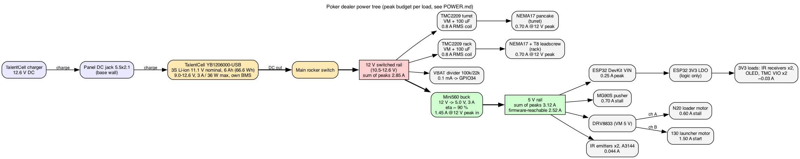

# Power budget

Source of every number on this page: `electronics/power_budget.py` (deterministic, run
`python3 electronics/power_budget.py` to regenerate the tables, `--check` to assert the limits).
Power tree: [power.svg](power.svg) / [power.png](power.png). Wiring: [wiring.svg](wiring.svg).

## Supply

| Item | Value |
|---|---|
| Battery | TalentCell YB1206000-USB, 3S Li-ion, 11.1 V nominal (12.6 V full, ~9 V BMS cut), 6 Ah = 66.6 Wh, **36 W / 3 A max** on the 12 V DC output, own BMS + charger |
| Charging | TalentCell 12.6 V charger into the panel DC jack (5.5x2.1) on the base wall, wired to the battery DC input. The machine can stay switched off while charging. |
| Main switch | Rocker switch in series with battery + (12 V output). Everything, including the battery divider, is downstream of it, so the off-state draw is zero. |
| 12 V rail | TMC2209 VM x2 (100 uF / 25 V electrolytic at each driver), Mini560 input, VBAT divider |
| 5 V rail | Mini560 (3 A): ESP32 VIN, MG90S, DRV8833 VM (max 10.8 V, so it must be on 5 V), N20, 130 motor, IR emitters, A3144 |
| 3.3 V | ESP32 on-board LDO, logic only: IR receivers, OLED, TMC2209 VIO |

## Loads

Assumptions: TMC2209 set to 0.8 A RMS coil current. A chopper driver draws supply power, not coil
current: at 12 V a NEMA17 at 0.8 A RMS draws about 0.4-0.5 A while moving and 0.2 A holding
(copper loss 2 x 0.8^2 x R plus mechanical output). 0.70 A is budgeted as the peak during
acceleration. DC motors and the servo use stall/start-up surge as their peak. Mini560 efficiency
is 90 % under load and 80 % at light load.

| Load | Rail | Idle (A) | Typical (A) | Peak (A) | Peak @12 V (A) | Duty |
|---|---|---|---|---|---|---|
| Turret stepper (TMC2209 + NEMA17 pancake, 0.8 A RMS) | 12 V | 0.005 | 0.450 | 0.700 | 0.700 | moves before every card; holds otherwise |
| Rack stepper (TMC2209 + NEMA17 T8, 0.8 A RMS) | 12 V | 0.005 | 0.400 | 0.700 | 0.700 | moves before every card / load |
| Battery divider 100k/22k | 12 V | 0.000 | 0.000 | 0.000 | 0.000 | always (after switch) |
| ESP32 DevKit (WiFi/BT off) | 5 V | 0.050 | 0.080 | 0.250 | 0.116 | always |
| MG90S pusher servo | 5 V | 0.006 | 0.250 | 0.700 | 0.324 | ~0.4 s per dealt card; detached when idle |
| N20 loader motor (DRV8833 ch A) | 5 V | 0.000 | 0.120 | 0.600 | 0.278 | loading only (~0.5 s per card) |
| 130 launcher motor (DRV8833 ch B) | 5 V | 0.000 | 0.500 | 1.500 | 0.694 | dealing only; 1.5 A = start-up surge |
| IR emitters x2 + A3144 hall | 5 V | 0.044 | 0.044 | 0.044 | 0.020 | always |
| 3V3 loads: OLED, IR receivers x2, TMC VIO x2 | 5 V | 0.019 | 0.025 | 0.030 | 0.014 | always (via ESP32 LDO) |

"Peak @12 V" for a 5 V load = I5 x 5 V / 0.90 / 12 V.

## Peak draw at 12 V (requirement: < 3 A)

Math for case A:
* 12 V loads: 0.70 + 0.70 + 0.0001 = 1.40 A
* 5 V loads: 0.25 + 0.70 + 0.60 + 1.50 + 0.044 + 0.030 = 3.12 A -> 3.12 x 5 V / 0.90 = 17.4 W -> 17.4 / 12 = 1.45 A
* Total: 1.40 + 1.45 = **2.85 A < 3 A** at 12 V (34.2 W < 36 W battery limit)

| Peak case | 5 V rail (A) | 12 V rail (A) at 12.0 V | at 10.5 V cut-off | Power (W) |
|---|---|---|---|---|
| A. Sum of every peak (physically impossible: feed + launch never together) | 3.12 | **2.85** | 3.25 | 34.2 |
| B. Firmware-reachable worst case (A without the N20) | 2.52 | **2.57** | 2.94 | 30.8 |
| C. Realistic coincident peak (both steppers accelerating, launcher running) | 0.83 | **1.79** | 2.04 | 21.4 |

Notes:
* The constant-power loads (steppers via chopper, buck) draw more current as the battery sags.
  Even at the 10.5 V refuse-to-start threshold the firmware-reachable worst case (B) stays below 3 A.
  Case A at 10.5 V (3.25 A) cannot happen: the firmware never runs the loader and the launcher together,
  the servo only pushes after the launcher spin-up delay, and steppers are at their peak only while accelerating.
* The 5 V rail in case B (2.52 A) is inside the Mini560 3 A rating. The 130 motor start-up surge lasts
  ~50 ms. A soft PWM ramp in firmware (if implemented) lowers it further.
* Inrush at switch-on: 2 x 100 uF plus the buck input caps. The TalentCell output handles it.

## Idle draw

Idle = steppers disabled (EN high), servo detached, DC motors off, OLED on.
12 V: 2 x 5 mA TMC2209 quiescent + 0.1 mA divider = 10 mA.
5 V: ESP32 50 mA + servo (detached) 6 mA + IR emitters/hall 44 mA + 3V3 loads 19 mA = 119 mA,
through the buck at 80 %: 0.74 W.
**Idle total = 0.86 W = 72 mA at 12 V.** The IR emitters are the largest avoidable idle load
(see Known issues in the README: they could be switched by a GPIO in a later revision).

## Energy per hand and runtime

Six players: load 52 cards, deal 12 hole cards + 3 burns + 5 board cards = 20 dealt cards.
Both steppers are enabled for the whole active phase (shared EN), so their holding current counts.

| Phase (6 players) | Time (s) | Avg 12 V steppers (A) | Avg 5 V (A) | Avg power (W) | Energy (J) |
|---|---|---|---|---|---|
| Load 52 cards (0.7 s/card) | 36 | 0.45 | 0.248 | 6.8 | 247 |
| Deal 20 cards (1.2 s/card) | 24 | 0.65 | 0.754 | 12.0 | 288 |
| Home / park, 4 power-ups (3 s each) | 12 | 0.65 | 0.164 | 8.7 | 105 |
| Idle while players act (108 s of a 3 min hand) | 108 | 0.01 | 0.119 | 0.86 | 93 |
| **Total per hand** | 180 | | | | **732 J = 0.203 Wh** |

* Usable energy: 6 Ah x 11.1 V x 85 % (down to the 10.5 V cut-off) = **56.6 Wh**
* Hands per charge: 56.6 / 0.203 = **~278 hands**
* At 20 hands/h: **~13.9 h** of play. With a 2x safety factor (retries, stepper resonance, cold
  battery, ageing): **~7 h (~139 hands)**. Plan on one full evening per charge.
* Idle only (switched on, nothing dealt): 56.6 / 0.86 = **~65 h**. Off: 0 (switch is upstream of everything).

## Battery thresholds and divider

Divider: 100 k (top, from the switched 12 V rail) / 22 k (bottom, to GND), 100 nF from the mid
point to GND. Ratio = 22 / (100 + 22) = **0.1803**, firmware factor `VBAT_RATIO = 122/22 = 5.545`.

| Battery | GPIO34 voltage | Meaning |
|---|---|---|
| 12.6 V | 2.272 V | full |
| 11.1 V | 2.002 V | nominal |
| **10.9 V** | **1.966 V** | **warn** (~15 % left): LED/OLED warning, hand still allowed |
| **10.5 V** | **1.893 V** | **refuse** to start a hand ("charge battery") |
| 9.0 V | 1.623 V | TalentCell BMS cut-off (approx.) |

* GPIO34 is input-only, has no internal pull-up/down and goes to ADC1 (works with WiFi on).
  The firmware reads it with `analogReadMilliVolts()` (11 dB attenuation, eFuse calibrated).
* ADC range: the ESP32 11 dB range is accurate up to ~2.45 V, which corresponds to 13.6 V on the
  battery. Full charge (12.6 V) gives 2.27 V, so the full range is covered with margin.
* Absolute maximum: 3.3 V at the pin would need 18.3 V on the battery (3.6 V pin abs-max: 20 V).
  A 3S pack cannot reach that, so no clamp diode is needed.
* Divider current: 12.6 V / 122 k = 103 uA (only while switched on). Source impedance at the ADC
  is 100k || 22k = 18 k, and the 100 nF cap (tau 1.8 ms) gives the ADC sample-and-hold a stiff source.
  It also filters stepper noise. The firmware averages 8 samples.
* Accuracy: 1 % resistors + ADC calibration give about +/-2 % (+/-0.2 V at 10.9 V). Read the
  battery with a multimeter once and compare it with the value shown on the OLED / serial log.
  If they differ by more than 0.1 V, correct the divider ratio constant in `firmware/include/config.h`
  (see BUILD.md, calibration).
* Measure under load: the voltage sags ~0.2 V while the steppers move, so the firmware checks it
  before powering the motors (at hand start).
